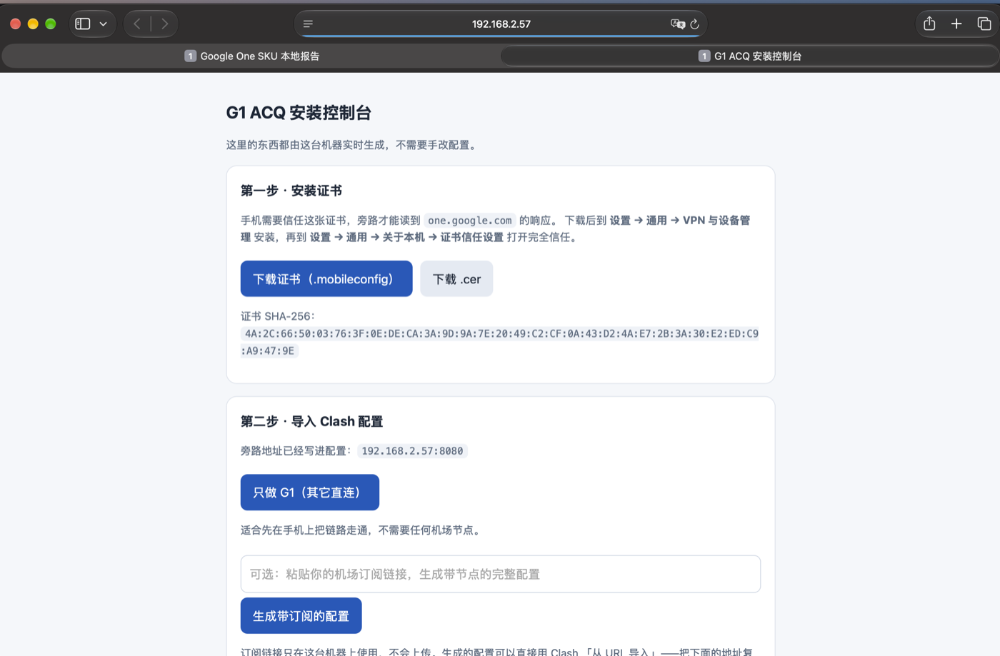

# g1-acq · Clash edition

[中文](README.md) · **English**

Rewrites and passively collects the **product IDs** behind the Google One (iOS) subscription
page, for **Clash - Rule Based Proxy** (mihomo core) and any other mihomo client.

> Doing this used to require Shadowrocket. This project moves the same trick onto Clash:
> Clash only does the routing, and the rewriting happens in a small sidecar running on a
> machine you own.

> ⚠️ **Research and interoperability testing only.** This project rewrites the product IDs
> a client receives in order to observe shop behaviour, which may violate the Google or Apple
> terms of service. Do not use it to obtain paid benefits without paying, and do not complete a
> purchase while testing. The authors take no responsibility for consequences and guarantee no
> product, price or entitlement.

---

## Origin and credits

This is a **Clash port** of [crhywun/g1-acq](https://github.com/crhywun/g1-acq). The original is
a Shadowrocket module; the mihomo core cannot do MITM, so the rewrite engine moved into a
sidecar on a machine you control — which lets people who did not buy Shadowrocket use the same
method.

The three-tier mapping, the SKU collection rules, the report fields and the two storage keys
(`g1.sku.scan.v1`, `g1.pro.annual.test.v1`) follow the original project, so its documentation
and findings still apply. The mapping table tracks upstream **v7.6.0**. The upstream declares no licence; if you know the author, please pass
the word along.

---

## Why one YAML file is not enough

Clash / mihomo is a **rule-based router**: it decides which outbound a connection takes, but it
**does not decrypt TLS and cannot rewrite a response body**. There is no MITM or rewrite entry in
mihomo's configuration schema (check with `mihomo -t` and the official docs), and the
[long-standing feature request](https://github.com/clash-verge-rev/clash-verge-rev/issues/727)
makes clear this is not something YAML can solve.

So the project is **two halves that cooperate**:

| Part | Runs on | Job |
|---|---|---|
| The generated Clash profile | your phone | Sends the single domain `one.google.com` to the sidecar and drops its QUIC |
| The sidecar (this project) | your Mac / VPS / NAS | Terminates TLS, applies the three-tier mapping, collects SKUs, serves the report |

The phone side is always just one `DOMAIN,one.google.com` rule. Your own proxy nodes are not
touched.

---

## Install in three steps



### 1. Install (one line)

```bash
curl -fsSL https://raw.githubusercontent.com/deveappcool-sys/g1-acq/main/install.sh | bash
```

It finds Python 3.12+, builds a virtualenv, registers a background service and finally
**prints a QR code**.

From a checkout, if you prefer:

```bash
git clone https://github.com/deveappcool-sys/g1-acq.git && cd g1-acq && ./install.sh
```

### 2. Configure (scan the code)

Put the phone on the same Wi-Fi, scan the QR code from the terminal, and the **setup console**
opens. It has exactly two jobs:

1. **Install the certificate** → download the `.mobileconfig` → install it from
   **Settings → General → VPN & Device Management** → then turn on **full trust** under
   **Settings → General → About → Certificate Trust Settings** (skipping that last switch
   means the certificate does nothing)
2. **Import the Clash profile** → the page shows an address and a QR code; use Clash's
   "import from URL"

Two flavours, one click apart:

| Option | Contents | When to use it |
|---|---|---|
| **G1 only** | Just the sidecar; everything else goes direct | Get the path working first; needs no proxy subscription at all |
| **With subscription** | Paste your subscription URL, get a complete profile with your nodes | Daily use; `PROXY` defaults to *your* nodes, only `one.google.com` goes to the sidecar |

### 3. Use it

Open Google One → tap a plan → **look at the App Store purchase sheet**.

> The price shown on the page **will not change**. The project only swaps product IDs; it never
> touches price fields. The real price is whatever the App Store returns for that ID, so the
> system sheet is the only thing worth reading.

Back on the console, once "last rewrite" shows a number, the rewrite is live.

---

## Run the self-check first

```bash
./.venv/bin/python -m g1acq doctor
```

It prints a report you can paste into an issue. Chinese is the default output language; add
`--lang en` (or set `G1_LANG=en`) for English, and use `?lang=en` on the console.

```
G1 ACQ 自检报告
========================================
✔ 旁路端口: 127.0.0.1:8080 可连接
✔ 安装控制台: 127.0.0.1:8090 可连接
✔ 状态文件: /Users/you/.g1-acq/state.json（6004 字节，最后写入 2026-11-24 15:58）
✔ 采集: 扫描 92 个响应，采集 35 个编号
✔ 最近改写: rewritten · 59 处（其中 2TB 30）
✔ 根证书: 4A:2C:66:50:...
✔ 本机地址: 192.168.2.57
· 版本: 8.2.0 / g1-acq-clash-v8.2
```

Key/value diagnostics such as `status=… addedCount=…` are **never translated**: they are parsed
and compared across versions, so they stay identical in both languages.

Full troubleshooting lives in **[docs/clash-setup.md](docs/clash-setup.md)** and the field
dictionary in **[docs/pro-annual-test.md](docs/pro-annual-test.md)** (both in Chinese).

---

## The three-tier mapping

The sidecar first collects candidate SKUs from any `https://one.google.com/` response, then
rewrites **only responses matching `/ai?`**, by complete source SKU:

| Complete source SKU in the body | Default target | Fallback target |
|---|---|---|
| any complete SKU prefixed `g1.ios.2tb.` | `g1.2tb.ai.12months_ip_90p` | none |
| `g1.ios.20tb.m.v2` | `g1.20tb.1month_eft.acq` | `g1.20tb.3months_ip_90p.acq` |
| `g1.ios.30tb.ai.pro.m` | `g1.ai.ultra.1month_eft.acq` | `g1.ai.ultra.3months_ip_90p.acq` |

- The 2TB tier is always replaced by the fixed candidate and has no fallback.
- 20TB and 30TB decide independently: if the one-month free trial (`1month_eft`) appears in the
  original body, use it; if it is absent and the matching three-month 90p appears, use 90p; if
  neither appears, still use `1month_eft`.
- The decision is made on **the response text**, not by querying a store catalogue.

Changing the table means editing one file: [`g1acq/config.py`](g1acq/config.py).

---

## Local report

The sidecar answers `https://one.google.com/g1-sku-report` (it is not a Google page):

| Address | Contents |
|---|---|
| `/g1-sku-report` | HTML report: counters, last 10 responses, last rewrite, candidate list |
| `/g1-sku-report?format=json` | `g1-sku-report.json` download |
| `/g1-sku-report?clear=1` | Wipe this tool's two records |

From the command line:

```bash
./.venv/bin/python -m g1acq report --state ~/.g1-acq/state.json
```

It **never stores** response bodies, request or response headers, query strings or full URLs, and
there is no network reporting of any kind.

---

## Turning it off

- **Pause the rewrite**: switch the `G1` group to `DIRECT` in Clash.
- **Remove it**: delete the `G1-MITM` proxy, the `G1` group and the three rules; then
  `launchctl bootout gui/$(id -u)/com.g1acq.sidecar` (Linux: `systemctl --user disable --now g1-acq`).
- **Remove the certificate**: delete the profile in iOS Settings and turn off the trust toggle.

---

## Offline verification

```bash
uv pip install --python .venv/bin/python pytest pyyaml
./.venv/bin/python -m pytest
```

140 tests across five layers:

| Layer | Contents |
|---|---|
| Rewrite contract | complete-token matching for all three tiers, the fixed 2TB candidate, free-trial preference and 90p fallback, URL scope, zero-match, collection dedupe and the 300-ID cap, the 10-event log, redaction, legacy records, report fields and HTML escaping |
| Profile generation | rules and outbounds in both modes, `PROXY` never defaulting to the sidecar, credentials, validation, no placeholder left behind |
| Setup console | live address, importable `/clash.yaml`, correct certificate MIME types, `/status.json` reflecting real state, 404 for unknown paths |
| Clash validation | real `mihomo -t` on generated profiles, every rule target and group member resolving, `one.google.com` before `MATCH`, the four-condition QUIC guard |
| End to end | fake Google + forwarder + real `mitmdump` + real `mihomo`, asserting the full chain rewrites all three tiers |

Cases that need `mitmdump`, `openssl` or `mihomo` skip automatically when those are missing. The
source IDs used in tests are synthetic samples, not evidence of what a store actually offers.

---

## Files

| File | Purpose |
|---|---|
| [`install.sh`](install.sh) | One-command install (Python, dependencies, service, self-check, QR) |
| [`run.sh`](run.sh) | Foreground start without registering a service (`./run.sh`) |
| [`g1_addon.py`](g1_addon.py) | mitmproxy entry point: rewrite, report page, console |
| [`g1acq/config.py`](g1acq/config.py) | Mapping, versions, storage keys, caps — **the single source of truth** |
| [`g1acq/profile.py`](g1acq/profile.py) + [`profile.template.yaml`](g1acq/profile.template.yaml) | Clash profile generation |
| [`g1acq/setup_console.py`](g1acq/setup_console.py) | The setup console |
| [`g1acq/doctor.py`](g1acq/doctor.py) | Self-check report |
| [`g1acq/ca.py`](g1acq/ca.py) | Certificate export and the MIME types iOS needs |
| [`g1acq/collector.py`](g1acq/collector.py) / [`rewriter.py`](g1acq/rewriter.py) / [`report.py`](g1acq/report.py) | Collection / rewrite / report |
| [`g1acq/network.py`](g1acq/network.py) | LAN address discovery |
| [`clash/g1-acq.snippet.yaml`](clash/g1-acq.snippet.yaml) | The three rules, for merging into an existing profile by hand |
| [`docs/`](docs/) | Deployment and field reference (Chinese) |

---

## Scope and privacy

- **Rewrite scope**: only responses under `https://one.google.com/` are read, and only URLs
  matching `^https://one.google.com/ai\?` are rewritten. Something like `one.google.com.evil`
  never matches.
- **Interception scope**: the sidecar only decrypts `one.google.com` (enforced with
  `allow_hosts`); everything else is tunnelled untouched.
- **Privileges**: no root required, no location, photo or notification access.
- **Global impact**: QUIC is dropped **only for `one.google.com`**, so other apps keep HTTP/3.
- **No authentication by default**: the intended setup is your own machine on your own LAN.
  Anyone on that LAN can use the port as a proxy and read the report page, so **do not expose
  port 8080 to the internet**. On a VPS, start it with `G1_AUTH=user:password ./install.sh` (or
  `serve --auth`) and put the same credentials into the `G1-MITM` proxy in Clash.
- **The CA private key** (`~/.mitmproxy/mitmproxy-ca.pem`) is equivalent to the ability to
  impersonate any site; never leak it or commit it.
- **What is not evidence**: a hit count proves a string was replaced. It does not prove the App
  Store accepted that product, nor anything about billing periods or entitlements.
