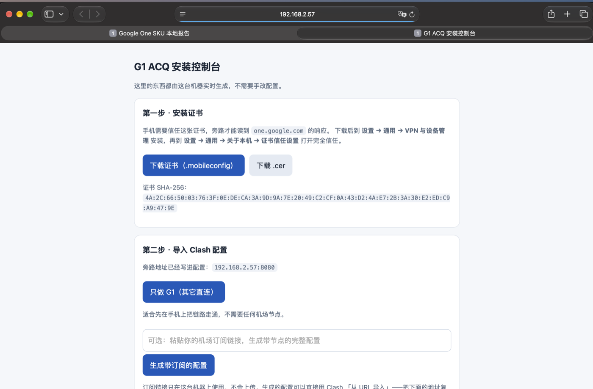

# g1-acq · Clash 版

Google One（iOS）订阅入口的**商品 ID 改写与被动采集**工具，用于 **Clash - Rule Based Proxy**（mihomo 内核）及其它 mihomo 客户端。

> ⚠️ **仅供研究与兼容性测试。** 本项目通过改写客户端收到的商品编号来观察商店行为，这可能违反 Google / Apple 的服务条款；请勿用于获取未付费的权益，测试过程中不要真正完成购买。作者不对使用后果负责，也不保证任何商品、价格或权益可用。

---

## 先说清楚：为什么不是一个 YAML 就够

Clash / mihomo 是**规则分流器**：它决定一条连接走哪个出口，但**不会解密 TLS，也没有响应体改写能力**。mihomo 的配置项里不存在 MITM、rewrite 一类的条目（可用 `mihomo -t` 与官方文档核对），社区的[重写功能请求](https://github.com/clash-verge-rev/clash-verge-rev/issues/727)也说明这不是改 YAML 能解决的事。

所以本项目是**两部分协同**：

| 部分 | 跑在哪 | 职责 |
|---|---|---|
| 生成的 Clash 配置 | 手机 | 把 `one.google.com` 这一条域名送到旁路，并丢掉它的 QUIC |
| 旁路服务（本项目） | 你自己的 Mac / VPS / NAS | 终止 TLS、执行三档改写、被动采集、提供报告页 |

手机侧永远只是一条 `DOMAIN,one.google.com` 规则；你的机场节点不受影响。

---

## 三步装好



### ① 装（一行）

```bash
curl -fsSL https://raw.githubusercontent.com/crhywun/g1-acq/main/install.sh | bash
```

它会自动找 Python 3.12+、建虚拟环境、注册开机自启，最后**打印一个二维码**。

想在仓库里跑也行：

```bash
git clone https://github.com/crhywun/g1-acq.git && cd g1-acq && ./install.sh
```

### ② 配（手机扫那个码）

手机连同一个 Wi-Fi，扫终端里的二维码 → 打开**安装控制台**，上面只有两件事：

1. **安装证书** → 下载 `.mobileconfig` → 到 **设置 → 通用 → VPN 与设备管理** 安装 →
   再到 **设置 → 通用 → 关于本机 → 证书信任设置** 打开**完全信任**（这步不做等于没装）
2. **导入 Clash 配置** → 页面给出地址和二维码，用 Clash「从 URL 导入」

配置有两种，页面上一键切换：

| 选项 | 内容 | 什么时候用 |
|---|---|---|
| **只做 G1** | 只有旁路，其它流量直连 | 先把链路走通，不需要任何机场节点 |
| **带订阅** | 粘贴你的机场订阅链接，生成带节点的完整配置 | 日常使用；`PROXY` 默认走你自己的节点，只有 `one.google.com` 走旁路 |

### ③ 用

打开 Google One → 点一个方案 → **看 App Store 弹出的购买面板**。

> 页面上显示的价格**不会变**——项目只替换商品 ID，不碰价格字段。真正的价格是 App Store 按商品 ID 返回的，所以只看那个系统弹窗。

回到控制台，「最近改写」出现数字就说明改写生效了。

---

## 出问题先跑自检

```bash
./.venv/bin/python -m g1acq doctor
```

输出一段可以直接贴到 issue 的报告：

```
G1 ACQ 自检报告
========================================
✔ 旁路端口: 127.0.0.1:8080 可连接
✔ 安装控制台: 127.0.0.1:8090 可连接
✔ 状态文件: /Users/you/.g1-acq/state.json（6004 字节，最后写入 2026-11-24 15:58）
✔ 采集: 扫描 92 个响应，采集 35 个编号
✔ 最近改写: rewritten · 59 处（其中 2TB 30）
✔ 根证书: 4A:2C:66:50:...
✔ 本机地址: 192.168.2.57
· 版本: 8.1.0 / g1-acq-clash-v8.0
```

完整排错见 **[docs/clash-setup.md](docs/clash-setup.md)**，实机核对与字段字典见 **[docs/pro-annual-test.md](docs/pro-annual-test.md)**。

---

## 三档映射

旁路先从 `https://one.google.com/` 的原始响应里采集候选 SKU，然后**只对匹配 `/ai?` 的响应**按完整源 SKU 改写：

| 正文中的完整源 SKU | 默认目标 | 备用目标 |
|---|---|---|
| `g1.ios.2tb.` 前缀的完整 SKU | `g1.2tb.ai.12months_ip_90p` | 无 |
| `g1.ios.20tb.m.v2` | `g1.20tb.3months_ip_90p.acq` | `g1.20tb.3months_ip_75p.acq` |
| `g1.ios.30tb.ai.pro.m` | `g1.ai.ultra.3months_ip_90p.acq` | `g1.ai.ultra.3months_ip_75p.acq` |

- 2TB 档固定替换为候选，没有备用档。
- 20TB / 30TB 各自独立判断：90p 出现在原文就用 90p；90p 缺席而对应 75p 出现时用 75p；两者都没有时仍用 90p。
- 判断依据是**响应正文字符串**，不是向 App Store 查询商品目录。

改映射表只改一个文件：[`g1acq/config.py`](g1acq/config.py)。

---

## 本地报告

旁路会应答 `https://one.google.com/g1-sku-report`（不是 Google 的页面）：

| 地址 | 内容 |
|---|---|
| `/g1-sku-report` | HTML 报告：采集计数、最近 10 次响应、最近一次三档映射、候选清单 |
| `/g1-sku-report?format=json` | `g1-sku-report.json` 下载 |
| `/g1-sku-report?clear=1` | 清空本工具的两份记录 |

命令行也能看：

```bash
./.venv/bin/python -m g1acq report --state ~/.g1-acq/state.json
```

**不保存**完整响应正文、请求头、响应头、query 或完整 URL；没有网络上报。

---

## 关闭与回滚

- **临时关掉改写**：Clash 里把 `G1` 组切到 `DIRECT`
- **彻底移除**：删掉配置里的 `G1-MITM`、`G1` 组和三条规则；停服务 `launchctl bootout gui/$(id -u)/com.g1acq.sidecar`（Linux 用 `systemctl --user disable --now g1-acq`）
- **删掉证书**：iOS 设置里移除描述文件，并关闭证书信任

---

## 离线验证

```bash
uv pip install --python .venv/bin/python pytest pyyaml
./.venv/bin/python -m pytest
```

140 个测试，五层：

| 层 | 内容 |
|---|---|
| 改写契约 | 三档完整编号匹配、2TB 固定候选、20TB/30TB 的 90p 优先与 75p 独立回退、URL 范围、零命中、采集去重与 300 上限、最近 10 条事件、脱敏、旧记录兼容、报告字段与 HTML 转义 |
| 配置生成 | 两种模式的规则与出口、`PROXY` 默认不走旁路、认证字段、参数校验、无占位符残留 |
| 安装控制台 | 页面地址实时正确、`/clash.yaml` 可导入、证书 MIME 正确、`/status.json` 反映真实状态、未知路径 404 |
| Clash 校验 | 用真实 `mihomo -t` 解析生成的配置，每条规则出口与策略组成员都能解析，`one.google.com` 在 `MATCH` 之前，QUIC 守卫四条件齐全 |
| 端到端 | 假 Google + 转发器 + 真实 `mitmdump` + 真实 `mihomo`，验证整条链路改写出三档目标 |

缺 `mitmdump` / `openssl` / `mihomo` 时对应用例自动 skip。测试里的源编号是合成样本，不构成商店上架或实机购买证据。

---

## 文件说明

| 文件 | 用途 |
|---|---|
| [`install.sh`](install.sh) | 一键安装（Python、依赖、后台服务、自检、二维码） |
| [`run.sh`](run.sh) | 不想注册服务时，前台直接启动（`./run.sh`） |
| [`g1_addon.py`](g1_addon.py) | mitmproxy 插件入口：响应改写、报告页、控制台 |
| [`g1acq/config.py`](g1acq/config.py) | 三档映射、版本、存储键、上限——**唯一事实来源** |
| [`g1acq/profile.py`](g1acq/profile.py) + [`profile.template.yaml`](g1acq/profile.template.yaml) | 生成 Clash 配置 |
| [`g1acq/setup_console.py`](g1acq/setup_console.py) | 安装控制台 |
| [`g1acq/doctor.py`](g1acq/doctor.py) | 自检报告 |
| [`g1acq/ca.py`](g1acq/ca.py) | 证书导出与 iOS 需要的 MIME 类型 |
| [`g1acq/collector.py`](g1acq/collector.py) / [`rewriter.py`](g1acq/rewriter.py) / [`report.py`](g1acq/report.py) | 采集 / 改写 / 报告 |
| [`g1acq/network.py`](g1acq/network.py) | 局域网地址探测 |
| [`clash/g1-acq.snippet.yaml`](clash/g1-acq.snippet.yaml) | 想手动合并进现有配置时的三条规则 |
| [`docs/`](docs/) | 部署排错、实机核对 |

---

## 边界与隐私

- **改写范围**：只有 `https://one.google.com/` 的响应会被读取，只有 `^https://one.google.com/ai\?` 会被改写。`one.google.com.evil` 之类不会匹配。
- **解密范围**：旁路只对 `one.google.com` 做 TLS 拦截（`allow_hosts` 限制），其它流量原样隧道转发。
- **权限**：旁路不需要 root，不申请定位、相册、通知。
- **全局影响**：QUIC 拦截**只作用于 `one.google.com`**，不影响其它 App 的 HTTP/3。
- **无认证默认**：旁路默认不设密码，因为目标场景是"自己机器 + 自己局域网"。同一 Wi-Fi 下其它人能用它当代理、能读报告页，所以**不要把 8080 暴露到公网**；真要放到 VPS 上，用 `G1_AUTH=用户:密码 ./install.sh` 或 `serve --auth`，并在 Clash 的 `G1-MITM` 里填同样的凭据。
- **CA 私钥**（`~/.mitmproxy/mitmproxy-ca.pem`）等同于可以伪造任意站点证书，不要泄露、不要提交进仓库。
- **不算证据的地方**：命中计数只证明字符串替换成功，不证明 App Store 接受该商品，也不证明订阅周期或权益。
